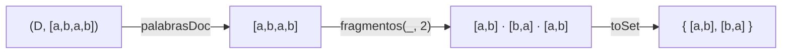
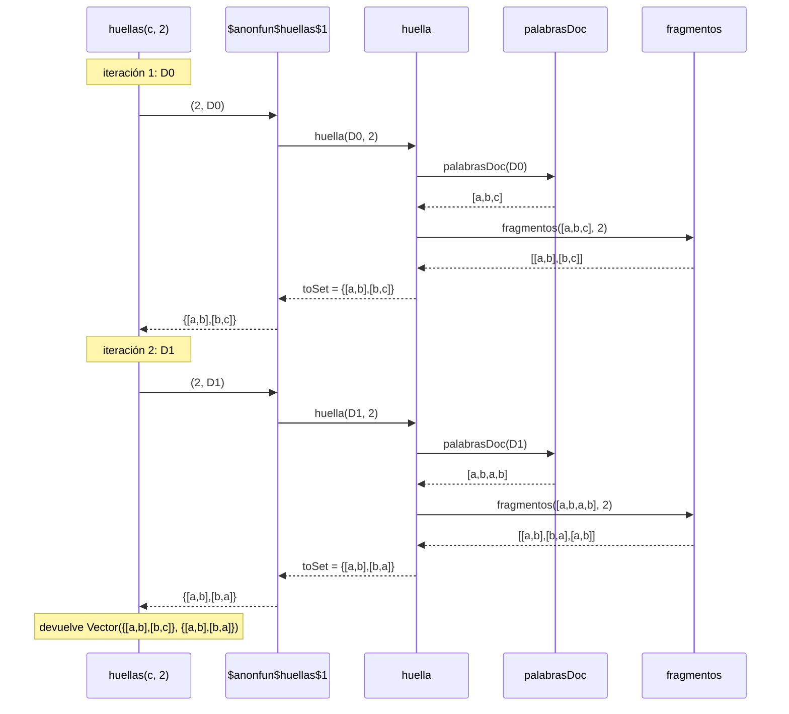
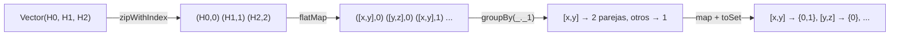
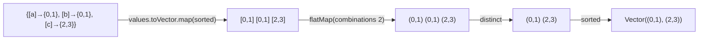
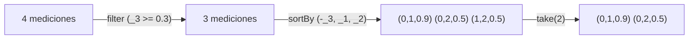
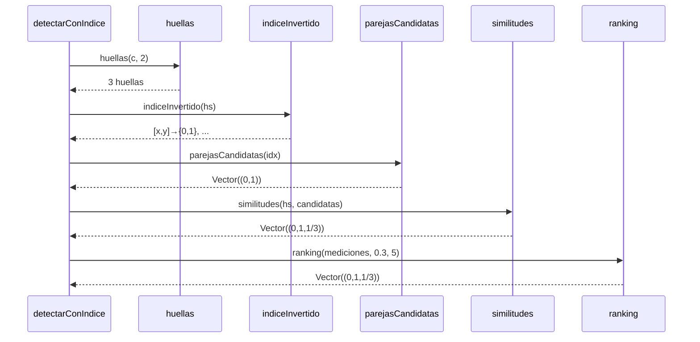

```mermaid
flowchart LR
    A["&quot;¡Expecto Patronum!&quot;"] -->|toLowerCase| B["&quot;¡expecto patronum!&quot;"]
    B -->|"StringOps.map"| C["&quot; expecto patronum &quot;"]
    C -->|"StringOps.split(' ')"| D["'' · expecto · patronum"]
    D -->|"ArrayOps.filter"| E["expecto · patronum"]
    E -->|"wrapRefArray.toVector"| F["Vector(expecto, patronum)"]
```

# Informe de proceso

Este informe muestra cómo se ejecuta cada función de la solución secuencial,
llamado por llamado e iteración por iteración, y en qué operaciones la
traduce el compilador.

## Cómo traduce el compilador nuestro código

En `normalizar`, `huella` y `huellas` usamos llamados a `map`, `filter`,
`split`, `toSet` y `toVector`. Aquí se explica qué hace el compilador con esos
llamados.

Para no suponerlo, compilamos `Similitud.scala` con el compilador de Scala
2.13.11 (el del proyecto) pidiéndole que muestre el código después de dos de
sus fases:

```bash
scalac -Xprint:typer      Similitud.scala   # después de revisar los tipos
scalac -Xprint:delambdafy Similitud.scala   # después de convertir las lambdas
```

En esas dos fases el compilador hace tres cosas sobre nuestro código:

1. Inserta conversiones implícitas. `String` y `Array` son clases de Java y
   no tienen métodos como `map` o `filter`. El compilador envuelve el valor en
   una clase de Scala que sí los tiene, usando conversiones definidas en
   `scala.Predef`:
   - `augmentString(s)` convierte un `String` en `StringOps`.
   - `refArrayOps(a)` convierte un `Array` en `ArrayOps`.
   - `wrapRefArray(a)` convierte un `Array` en una colección de Scala.
   - `charWrapper(c)` convierte un `Char` en `RichChar`.

   `Vector` y `Set` ya son colecciones de Scala, así que sobre ellos el llamado
   queda directo, sin conversión.
2. Convierte esos métodos en métodos estáticos de extensión. Por ejemplo,
   `augmentString(s).map(f)` termina como `StringOps.map$extension(s, f)`: no
   se crea ningún objeto `StringOps` en tiempo de ejecución.
3. Convierte cada lambda en un método. Cada función anónima `x => ...` pasa
   a ser un método estático con un nombre como `$anonfun$normalizar$1`, y en
   el punto donde estaba la lambda queda un objeto función que apunta a ese
   método. Si la lambda usa una variable de afuera (como `k` en `huellas`),
   esa variable se le pasa como parámetro extra al método.

---

## Punto 1: `normalizar`

```scala
def normalizar(texto: String): Vector[String] = {
  val minuscula  = texto.toLowerCase
  val conEspacio = minuscula.map(char => if (char.isLetterOrDigit) char else ' ')
  val divide     = conEspacio.split(' ')
  val filtra     = divide.filter(letras => letras.nonEmpty)
  filtra.toVector
}
```

`normalizar` no es recursiva: es una cadena de transformaciones, cada una
aplicada sobre el resultado de la anterior.

#### Paso a paso con `normalizar("¡Expecto Patronum!")`

| Paso | Operación | Valor |
|---|---|---|
| 1 | `texto.toLowerCase` | `"¡expecto patronum!"` |
| 2 | `map` carácter a carácter | `" expecto patronum "` |
| 3 | `split(' ')` | `Array("", "expecto", "patronum")` |
| 4 | `filter(_.nonEmpty)` | `Array("expecto", "patronum")` |
| 5 | `toVector` | `Vector("expecto", "patronum")` |

En el paso 3, el espacio del comienzo (el que dejó `¡`) produce una cadena
vacía `""` al principio del arreglo; el filtro del paso 4 la elimina. El espacio
final (el que dejó `!`) no produce cadena vacía porque `split` descarta las
vacías del final.

#### Cómo lo traduce el compilador

Después de la fase `typer`, el cuerpo de `normalizar` queda así (salida real
del compilador):

```scala
val minuscula: String = texto.toLowerCase();
val conEspacio: String = scala.Predef.augmentString(minuscula).map(((char: Char) =>
  if (scala.Predef.charWrapper(char).isLetterOrDigit) char else ' '));
val divide: Array[String] = scala.Predef.augmentString(conEspacio).split(' ');
val filtra: Array[String] = scala.Predef.refArrayOps[String](divide).filter(((letras: String) =>
  scala.Predef.augmentString(letras).nonEmpty));
scala.Predef.wrapRefArray[String](filtra).toVector
```

Y después de la fase `delambdafy`:

```scala
val minuscula: String = texto.toLowerCase();
val conEspacio: String = StringOps.map$extension(augmentString(minuscula), $anonfun$normalizar$1);
val divide: Array[String] = StringOps.split$extension(augmentString(conEspacio), ' ');
val filtra: Array[String] = ArrayOps.filter$extension(refArrayOps(divide), $anonfun$normalizar$2);
...

def $anonfun$normalizar$1(char: Char): Char =
  if (RichChar.isLetterOrDigit$extension(charWrapper(char))) char else ' ';
def $anonfun$normalizar$2(letras: String): Boolean =
  StringOps.nonEmpty$extension(augmentString(letras));
```

Línea por línea:

| Paso | Lo que escribimos | Lo que genera el compilador |
|---|---|---|
| 1 | `texto.toLowerCase` | `texto.toLowerCase()`: método de `java.lang.String`, sin conversión. |
| 2 | `minuscula.map(char => ...)` | `StringOps.map$extension(augmentString(minuscula), f)`. La lambda pasa a ser el método `$anonfun$normalizar$1(char: Char): Char`. Como la función devuelve `Char`, se usa la versión de `map` que devuelve `String`. |
| 2 | `char.isLetterOrDigit` | `RichChar.isLetterOrDigit$extension(charWrapper(char))`. |
| 3 | `conEspacio.split(' ')` | `StringOps.split$extension(augmentString(conEspacio), ' ')`, que devuelve `Array[String]`. |
| 4 | `divide.filter(letras => ...)` | `ArrayOps.filter$extension(refArrayOps(divide), f)`. La lambda pasa a ser el método `$anonfun$normalizar$2(letras: String): Boolean`. |
| 4 | `letras.nonEmpty` | `StringOps.nonEmpty$extension(augmentString(letras))`. |
| 5 | `filtra.toVector` | `wrapRefArray(filtra).toVector`: el arreglo se envuelve como colección de Scala y de ahí se copia a un `Vector`. |

#### Iteración por iteración

Paso 1: `toLowerCase`.Un solo llamado sobre todo el texto:

```scala
"¡Expecto Patronum!".toLowerCase   // "¡expecto patronum!"
```

Paso 2: `StringOps.map$extension` sobre `"¡expecto patronum!"`. El `map`
recorre los 18 caracteres uno por uno; en cada iteración llama a
`$anonfun$normalizar$1(char)` y agrega lo que devuelve al `String` que está
construyendo.

| Iteración | `char` | `char.isLetterOrDigit` | `$anonfun$normalizar$1(char)` | Resultado acumulado |
|---|---|---|---|---|
| 1 | `'¡'` | `false` | `' '` | `" "` |
| 2 | `'e'` | `true` | `'e'` | `" e"` |
| 3 | `'x'` | `true` | `'x'` | `" ex"` |
| 4 | `'p'` | `true` | `'p'` | `" exp"` |
| 5 | `'e'` | `true` | `'e'` | `" expe"` |
| 6 | `'c'` | `true` | `'c'` | `" expec"` |
| 7 | `'t'` | `true` | `'t'` | `" expect"` |
| 8 | `'o'` | `true` | `'o'` | `" expecto"` |
| 9 | `' '` | `false` | `' '` | `" expecto "` |
| 10 | `'p'` | `true` | `'p'` | `" expecto p"` |
| 11 | `'a'` | `true` | `'a'` | `" expecto pa"` |
| 12 | `'t'` | `true` | `'t'` | `" expecto pat"` |
| 13 | `'r'` | `true` | `'r'` | `" expecto patr"` |
| 14 | `'o'` | `true` | `'o'` | `" expecto patro"` |
| 15 | `'n'` | `true` | `'n'` | `" expecto patron"` |
| 16 | `'u'` | `true` | `'u'` | `" expecto patronu"` |
| 17 | `'m'` | `true` | `'m'` | `" expecto patronum"` |
| 18 | `'!'` | `false` | `' '` | `" expecto patronum "` |

Las iteraciones 1 y 18 son las que cambian algo: los signos de exclamación `¡`
y `!` se vuelven espacios. La iteración 9 también da `false`, pero el carácter
ya era un espacio.

Paso 3: `StringOps.split$extension`. Un solo llamado. Corta el texto en
cada espacio:

```scala
" expecto patronum ".split(' ')   // Array("", "expecto", "patronum")
```

Paso 4: `ArrayOps.filter$extension` sobre
`Array("", "expecto", "patronum")`. El `filter` recorre los 3 trozos; en cada
iteración llama a `$anonfun$normalizar$2(letras)` y, si devuelve `true`,
agrega el trozo al arreglo nuevo que está construyendo.

| Iteración | `letras` | `$anonfun$normalizar$2(letras)` | ¿Lo conserva el `filter`? | Resultado acumulado |
|---|---|---|---|---|
| 1 | `""` | `false` | no | `Array()` |
| 2 | `"expecto"` | `true` | sí | `Array("expecto")` |
| 3 | `"patronum"` | `true` | sí | `Array("expecto", "patronum")` |

Paso 5: `wrapRefArray(...).toVector`. Un solo llamado que copia el arreglo
a un vector:

```scala
Array("expecto", "patronum").toVector   // Vector("expecto", "patronum")
```



---

## `huella`

```scala
def huella(d: Documento, k: Int): Huella = {
  val palabras = palabrasDoc(d)
  val frags    = fragmentos(palabras, k)
  frags.toSet
}
```

`huella` no es recursiva: toma las palabras del documento, calcula sus
fragmentos con `fragmentos` y convierte el vector en conjunto. La conversión
`toSet` es la que hace que un fragmento repetido cuente una sola vez.

#### Cómo lo traduce el compilador

Salida de la fase `typer`:

```scala
val palabras: Vector[String] = Similitud.this.palabrasDoc(d);
val frags: Vector[Fragmento] = Similitud.this.fragmentos(palabras, k);
frags.toSet[Fragmento]
```

Aquí el compilador no inserta conversiones ni crea lambdas: los dos primeros
son llamados directos a métodos del objeto `Similitud`, y `toSet` es un método
que `Vector` ya tiene. Lo único que agrega es el parámetro de tipo:
`toSet[Fragmento]`, es decir, el conjunto resultante es un `Set[Vector[String]]`.

#### Paso a paso con `huella(("D", Vector("a", "b", "a", "b")), 2)`

| Paso | Operación | Valor |
|---|---|---|
| 1 | `palabrasDoc(d)` | `Vector(a, b, a, b)` |
| 2 | `fragmentos(palabras, 2)` | `Vector([a,b], [b,a], [a,b])` |
| 3 | `toSet` | `Set([a,b], [b,a])` |

#### Llamado por llamado

```scala
huella(("D", Vector("a", "b", "a", "b")), 2)
  palabrasDoc(("D", Vector("a", "b", "a", "b")))   // Vector(a, b, a, b)
  fragmentos(Vector(a, b, a, b), 2)                // Vector([a,b], [b,a], [a,b])
  Vector([a,b], [b,a], [a,b]).toSet                // Set([a,b], [b,a])
```

`toSet` recorre el vector de fragmentos y va agregando cada uno a un conjunto
que empieza vacío. Si el fragmento ya está, el conjunto no cambia:

| Iteración | Fragmento | ¿Ya estaba? | Conjunto acumulado |
|---|---|---|---|
| — | — | — | `Set()` |
| 1 | `[a,b]` | no | `Set([a,b])` |
| 2 | `[b,a]` | no | `Set([a,b], [b,a])` |
| 3 | `[a,b]` | sí | `Set([a,b], [b,a])` |

El vector del paso 2 tiene $t - k + 1 = 3$ fragmentos, pero `[a,b]` aparece dos
veces (iteraciones 1 y 3), así que la huella queda con 2. Por eso en general

$$|\text{huella}(d, k)| \le t - k + 1.$$



## `huellas`

```scala
def huellas(c: Corpus, k: Int): Vector[Huella] =
  c.map(documento => huella(documento, k))
```

`huellas` aplica `huella` a cada documento del corpus y conserva el orden, de
modo que la huella en la posición `i` corresponde al documento `i`. Esa
correspondencia es la que usan después `indiceInvertido` y `similitudes` para
identificar los documentos por su posición.

#### Cómo lo traduce el compilador

Salida de la fase `typer`:

```scala
c.map[Huella](((documento: Documento) => Similitud.this.huella(documento, k)))
```

Salida de la fase `delambdafy`:

```scala
def huellas(c: Vector, k: Int): Vector = c.map($anonfun(k))

def $anonfun$huellas$1(k$1: Int, documento: Tuple2): Set = Similitud.huella(documento, k$1);
```

- `c` es un `Vector`, así que `map` se llama directo, sin conversión implícita.
- El compilador fija el tipo del resultado: `map[Huella]`.
- La lambda `documento => huella(documento, k)` pasa a ser el método
  `$anonfun$huellas$1`. Como la lambda usa `k`, que viene de afuera, el
  compilador se lo pasa como primer parámetro (`k$1`), y en el lugar de la
  lambda queda `$anonfun(k)`: un objeto función que ya trae guardado el valor
  de `k`.

#### Paso a paso con un corpus de dos documentos y `k = 2`

```scala
val c = Vector(("D0", Vector("a", "b", "c")), ("D1", Vector("a", "b", "a", "b")))
huellas(c, 2)
```

| Elemento que recorre el `map` | Lo que devuelve `$anonfun$huellas$1(2, documento)` |
|---|---|
| `("D0", [a,b,c])` | `huella(_, 2) = {[a,b], [b,c]}` |
| `("D1", [a,b,a,b])` | `huella(_, 2) = {[a,b], [b,a]}` |

#### Iteración por iteración

El `map` hace una iteración por documento, y en cada una llama a
`$anonfun$huellas$1(2, documento)`, que a su vez hace un llamado completo a
`huella`:

Iteración 1 — `documento = ("D0", Vector(a, b, c))`:

```scala
$anonfun$huellas$1(2, ("D0", Vector(a, b, c)))
  huella(("D0", Vector(a, b, c)), 2)
    palabrasDoc(("D0", Vector(a, b, c)))   // Vector(a, b, c)
    fragmentos(Vector(a, b, c), 2)         // Vector([a,b], [b,c])
    Vector([a,b], [b,c]).toSet             // Set([a,b], [b,c])
```

Resultado acumulado: `Vector({[a,b], [b,c]})`.

Iteración 2 — `documento = ("D1", Vector(a, b, a, b))`:

```scala
$anonfun$huellas$1(2, ("D1", Vector(a, b, a, b)))
  huella(("D1", Vector(a, b, a, b)), 2)
    palabrasDoc(("D1", Vector(a, b, a, b)))   // Vector(a, b, a, b)
    fragmentos(Vector(a, b, a, b), 2)         // Vector([a,b], [b,a], [a,b])
    Vector([a,b], [b,a], [a,b]).toSet         // Set([a,b], [b,a])
```

Resultado acumulado: `Vector({[a,b], [b,c]}, {[a,b], [b,a]})`.

No quedan documentos, así que el `map` termina.



Resultado: `Vector({[a,b], [b,c]}, {[a,b], [b,a]})`, una huella por documento y
en el mismo orden del corpus.

---

## Punto 2.6: `jaccard`

```scala
def jaccard(h1: Huella, h2: Huella): Double = {
  val comunes = h1.intersect(h2)
  val unidos = h1.union(h2)
  if (unidos.isEmpty) 0.0
  else comunes.size.toDouble / unidos.size
}
```

#### Paso a paso

Tomemos `h1 = Set(Vector("sol"), Vector("luna"))` y
`h2 = Set(Vector("sol"))`.

| Paso | Operación | Valor |
|---|---|---|
| 1 | `h1.intersect(h2)` | `Set(Vector("sol"))` |
| 2 | `h1.union(h2)` | `Set(Vector("sol"), Vector("luna"))` |
| 3 | `unidos.isEmpty` | `false`, así que se toma el `else` |
| 4 | `comunes.size.toDouble / unidos.size` | `1.0 / 2 = 0.5` |

Si las dos huellas llegan vacías, en el paso 3 se toma la otra rama y el
resultado es `0.0`. Ahí no se hace la división.

#### Cómo lo traduce el compilador

`intersect` y `union` quedan como llamados directos sobre `Set`. No hay
ningún `for` ni funciones anónimas. La división se hace con `Double`,
porque el numerador se convierte con `toDouble`.

---

## Punto 2.7: `parejas`

```scala
def parejas(n: Int): Vector[Pareja] = {
  for {
    primera <- (0 until n).toVector
    segunda <- (primera + 1) until n
  } yield (primera, segunda)
}
```

#### Cómo lo traduce el compilador

El `for` tiene dos recorridos. El de afuera se traduce a `flatMap` y el de
adentro a `map`. Es equivalente a escribirlo así:

```scala
(0 until n).toVector.flatMap { primera =>
  ((primera + 1) until n).map { segunda =>
    (primera, segunda)
  }
}
```

El `map` arma las parejas para una primera posición y el `flatMap` las
junta en un solo vector, sin dejar un vector por cada posición.

#### Paso a paso con `parejas(4)`

| `primera` | Valores de `segunda` | Parejas que se agregan |
|---|---|---|
| `0` | `1`, `2`, `3` | `(0,1)`, `(0,2)`, `(0,3)` |
| `1` | `2`, `3` | `(1,2)`, `(1,3)` |
| `2` | `3` | `(2,3)` |
| `3` | ninguno | ninguna |

Al final queda `Vector((0,1), (0,2), (0,3), (1,2), (1,3), (2,3))`.

---

## Punto 2.8: `similitudes`

```scala
def similitudes(hs: Vector[Huella], ps: Vector[Pareja]): Vector[Medicion] = {
  ps.map { case (primera, segunda) =>
    val similitud = jaccard(hs(primera), hs(segunda))
    (primera, segunda, similitud)
  }
}
```

#### Paso a paso

Tomemos `hs = Vector(Set(Vector("sol")), Set(Vector("sol"), Vector("luna")),
Set(Vector("luna")))` y pidamos `Vector((0,2), (0,1))`.

| Pareja | Llamado | Medición |
|---|---|---|
| `(0,2)` | `jaccard(hs(0), hs(2))` | `(0,2,0.0)` |
| `(0,1)` | `jaccard(hs(0), hs(1))` | `(0,1,0.5)` |

El resultado es `Vector((0,2,0.0), (0,1,0.5))`. La medición de cero se
queda y las parejas salen en el orden en que se pidieron.

#### Cómo lo traduce el compilador

El llamado a `map` va directo sobre el vector `ps`. `case (primera,
segunda)` separa las dos posiciones de cada tupla, y la función que se le
pasa al `map` usa `hs` para buscar las huellas.

---

## Punto 2.9: `indiceInvertido`

```scala
def indiceInvertido(hs: Vector[Huella]): Indice = {
  val conPosicion = hs.zipWithIndex
  val entradas    = conPosicion.flatMap(par => par._1.toVector.map(fragmento => (fragmento, par._2)))
  val agrupado    = entradas.groupBy(entrada => entrada._1)
  agrupado.map(grupo => (grupo._1, grupo._2.map(entrada => entrada._2).toSet))
}
```

`indiceInvertido` no es recursiva: son cuatro transformaciones encadenadas.
Primero se numera cada huella, después se convierte cada huella en parejas
`(fragmento, posición)`, luego se agrupan las parejas por fragmento y por último
se deja, para cada fragmento, el conjunto de posiciones.

#### Paso a paso con tres huellas

Corpus `("a", [x,y,z])`, `("b", [x,y,w])`, `("c", [p,q,r])` con `k = 2`; las
huellas son `H0 = {[x,y], [y,z]}`, `H1 = {[x,y], [y,w]}` y `H2 = {[p,q], [q,r]}`.

| Paso | Operación | Valor |
|---|---|---|
| 1 | `hs.zipWithIndex` | `Vector((H0,0), (H1,1), (H2,2))` |
| 2 | `flatMap` con `(fragmento, posición)` | `Vector(([x,y],0), ([y,z],0), ([x,y],1), ([y,w],1), ([p,q],2), ([q,r],2))` |
| 3 | `groupBy(_._1)` | `[x,y] → Vector(([x,y],0), ([x,y],1))`, `[y,z] → Vector(([y,z],0))`, ... |
| 4 | `map` que deja las posiciones y `toSet` | `[x,y] → {0,1}`, `[y,z] → {0}`, `[y,w] → {1}`, `[p,q] → {2}`, `[q,r] → {2}` |

El orden de las entradas de un `Map` no está definido; por eso las pruebas
comparan el mapa completo o consultan un fragmento, nunca su orden.

#### Cómo lo traduce el compilador

Salida de la fase `typer` (con los tipos ya inferidos, resumida):

```scala
val conPosicion: Vector[(Huella, Int)] = hs.zipWithIndex;
val entradas: Vector[(Fragmento, Int)] =
  conPosicion.flatMap[(Fragmento, Int)](((par: (Huella, Int)) =>
    par._1.toVector.map[(Fragmento, Int)](((fragmento: Fragmento) =>
      scala.Tuple2.apply[Fragmento, Int](fragmento, par._2)))));
val agrupado: Map[Fragmento, Vector[(Fragmento, Int)]] =
  entradas.groupBy[Fragmento](((entrada: (Fragmento, Int)) => entrada._1));
agrupado.map[Fragmento, Set[Int]](((grupo: (Fragmento, Vector[(Fragmento, Int)])) =>
  scala.Tuple2.apply[Fragmento, Set[Int]](grupo._1,
    grupo._2.map[Int](((entrada: (Fragmento, Int)) => entrada._2)).toSet[Int])))
```

Todo se llama directo sobre `Vector` y `Map`, que ya son colecciones de Scala:
no hay conversiones implícitas. Después de `delambdafy` cada lambda es un
método, y la lambda interna de `flatMap` recibe `par` como parámetro extra
porque lo usa desde afuera:

| Lo que escribimos | Método que genera el compilador |
|---|---|
| `par => par._1.toVector.map(...)` | `$anonfun$indiceInvertido$1(par: Tuple2): Vector` |
| `fragmento => (fragmento, par._2)` | `$anonfun$indiceInvertido$2(par$1: Tuple2, fragmento: Vector): Tuple2` |
| `entrada => entrada._1` | `$anonfun$indiceInvertido$3(entrada: Tuple2): Vector` |
| `grupo => (grupo._1, ...)` | `$anonfun$indiceInvertido$4(grupo: Tuple2): Tuple2` |
| `entrada => entrada._2` | `$anonfun$indiceInvertido$5(entrada: Tuple2): Int` |

#### Iteración por iteración

El `flatMap` hace una iteración por huella, y en cada una el `map` interno hace
una iteración por fragmento de esa huella:

| Iteración del `flatMap` | `par` | Parejas que agrega | Acumulado |
|---|---|---|---|
| 1 | `(H0, 0)` | `([x,y],0)`, `([y,z],0)` | 2 parejas |
| 2 | `(H1, 1)` | `([x,y],1)`, `([y,w],1)` | 4 parejas |
| 3 | `(H2, 2)` | `([p,q],2)`, `([q,r],2)` | 6 parejas |

El `groupBy` recorre esas 6 parejas y las deja en 5 grupos, porque `[x,y]`
aparece en dos. El último `map` hace una iteración por grupo: de cada uno toma
las posiciones y `toSet` las vuelve conjunto.



## Punto 2.10: `parejasCandidatas`

```scala
def parejasCandidatas(idx: Indice): Vector[Pareja] = {
  val conjuntos = idx.values.toVector.map(docs => docs.toVector.sorted)
  val todas     = conjuntos.flatMap(docs => docs.combinations(2).map(par => (par(0), par(1))).toVector)
  todas.distinct.sorted
}
```

No es recursiva. Toma los conjuntos de documentos del índice, de cada uno saca
todas las parejas `(i, j)` con `i < j`, quita las repetidas y ordena.

#### Paso a paso con el índice del ejemplo anterior

| Paso | Operación | Valor |
|---|---|---|
| 1 | `idx.values.toVector` | `Vector({0,1}, {0}, {1}, {2}, {2})` (el orden de `values` no está definido) |
| 2 | `map(docs => docs.toVector.sorted)` | `Vector([0,1], [0], [1], [2], [2])` |
| 3 | `flatMap` con `combinations(2)` | `Vector((0,1))` |
| 4 | `distinct` y `sorted` | `Vector((0,1))` |

Solo el fragmento `[x,y]` está en dos documentos, así que solo la pareja
`(0, 1)` es candidata; los documentos `0` y `2`, o `1` y `2`, no comparten nada y
nunca se comparan.

#### Cómo lo traduce el compilador

Salida de la fase `typer`:

```scala
val conjuntos: Vector[Vector[Int]] =
  idx.values.toVector.map[Vector[Int]](((docs: Set[Int]) =>
    docs.toVector.sorted[Int](math.this.Ordering.Int)));
val todas: Vector[(Int, Int)] =
  conjuntos.flatMap[(Int, Int)](((docs: Vector[Int]) =>
    docs.combinations(2).map[(Int, Int)](((par: Vector[Int]) =>
      scala.Tuple2.apply[Int, Int](par.apply(0), par.apply(1)))).toVector));
todas.distinct.sorted[(Int, Int)](math.this.Ordering.Tuple2[Int, Int](
  math.this.Ordering.Int, math.this.Ordering.Int))
```

El compilador agrega por su cuenta el parámetro implícito de `sorted`: el orden
`Ordering.Int` para los números y `Ordering.Tuple2(Int, Int)` para las parejas,
que compara primero `i` y, a igualdad, `j`. Las tres lambdas pasan a ser
`$anonfun$parejasCandidatas$1` (`docs => docs.toVector.sorted`), `$2` (la del
`flatMap`) y `$3` (`par => (par(0), par(1))`).

#### Iteración por iteración

Con el índice `{[a] → {0,1}, [b] → {0,1}, [c] → {2,3}}`:

| Iteración del `flatMap` | `docs` | `combinations(2)` | Acumulado |
|---|---|---|---|
| 1 | `[0,1]` | `(0,1)` | `(0,1)` |
| 2 | `[0,1]` | `(0,1)` | `(0,1) (0,1)` |
| 3 | `[2,3]` | `(2,3)` | `(0,1) (0,1) (2,3)` |

`distinct` quita la segunda `(0,1)` y `sorted` ordena las dos que quedan:
`Vector((0,1), (2,3))`. Una misma pareja puede salir de varios fragmentos, y
por eso el `distinct` es necesario.



## Punto 2.11: `ranking`

```scala
def ranking(ss: Vector[Medicion], umbral: Double, p: Int): Vector[Medicion] = {
  val sobreUmbral = ss.filter(medicion => medicion._3 >= umbral)
  val ordenadas   = sobreUmbral.sortBy(medicion => (-medicion._3, medicion._1, medicion._2))
  ordenadas.take(p)
}
```

No es recursiva: filtra las mediciones que alcanzan el umbral, las ordena de
mayor a menor similitud y se queda con las primeras `p`. La clave de orden
`(-similitud, i, j)` hace que los empates se resuelvan por posición, de modo que
el resultado no dependa del orden en que llegaron las mediciones.

#### Paso a paso con `ranking(Vector((1,2,0.5), (0,2,0.5), (0,1,0.9), (0,3,0.1)), 0.3, 2)`

| Paso | Operación | Valor |
|---|---|---|
| 1 | `filter(_._3 >= 0.3)` | `Vector((1,2,0.5), (0,2,0.5), (0,1,0.9))` |
| 2 | `sortBy((-_._3, _._1, _._2))` | `Vector((0,1,0.9), (0,2,0.5), (1,2,0.5))` |
| 3 | `take(2)` | `Vector((0,1,0.9), (0,2,0.5))` |

#### Cómo lo traduce el compilador

Salida de la fase `typer`:

```scala
val sobreUmbral: Vector[Medicion] =
  ss.filter(((medicion: Medicion) => medicion._3.>=(umbral)));
val ordenadas: Vector[Medicion] =
  sobreUmbral.sortBy[(Double, Int, Int)](((medicion: Medicion) =>
    scala.Tuple3.apply[Double, Int, Int](medicion._3.unary_-, medicion._1, medicion._2)))(
      math.this.Ordering.Tuple3[Double, Int, Int](
        math.this.Ordering.DeprecatedDoubleOrdering, math.this.Ordering.Int, math.this.Ordering.Int));
ordenadas.take(p)
```

- `-medicion._3` se vuelve `medicion._3.unary_-`: negar la similitud es lo que
  hace que el orden ascendente de la clave deje primero la mayor similitud.
- El compilador agrega el `Ordering.Tuple3` que compara las tres componentes
  una tras otra.
- La lambda del filtro usa `umbral`, que viene de afuera, así que después de
  `delambdafy` queda como `$anonfun$ranking$1(umbral$1: Double, medicion: Tuple3)`;
  la del `sortBy` no usa nada de afuera: `$anonfun$ranking$2(medicion: Tuple3)`.

#### Iteración por iteración

Paso 1, `filter` sobre 4 mediciones con `umbral = 0.3`:

| Iteración | `medicion` | `_3 >= 0.3` | ¿Se conserva? |
|---|---|---|---|
| 1 | `(1,2,0.5)` | `true` | sí |
| 2 | `(0,2,0.5)` | `true` | sí |
| 3 | `(0,1,0.9)` | `true` | sí |
| 4 | `(0,3,0.1)` | `false` | no |

Paso 2, la clave de cada medición que `sortBy` compara:

| Medición | Clave `(-similitud, i, j)` |
|---|---|
| `(1,2,0.5)` | `(-0.5, 1, 2)` |
| `(0,2,0.5)` | `(-0.5, 0, 2)` |
| `(0,1,0.9)` | `(-0.9, 0, 1)` |

El orden ascendente de las claves es `(-0.9,0,1) < (-0.5,0,2) < (-0.5,1,2)`:
la similitud 0.9 va primero, y las dos de 0.5 se desempatan por `i`.



## Punto 2.12: `detectarDirecto` y `detectarConIndice`

```scala
def detectarDirecto(c: Corpus, k: Int, umbral: Double, p: Int): Vector[Medicion] = {
  val hs         = huellas(c, k)
  val todas      = parejas(c.length)
  val mediciones = similitudes(hs, todas)
  ranking(mediciones, umbral, p)
}

def detectarConIndice(c: Corpus, k: Int, umbral: Double, p: Int): Vector[Medicion] = {
  val hs         = huellas(c, k)
  val idx        = indiceInvertido(hs)
  val candidatas = parejasCandidatas(idx)
  val mediciones = similitudes(hs, candidatas)
  ranking(mediciones, umbral, p)
}
```

Ninguna de las dos es recursiva ni crea lambdas: cada una es una cadena de
llamados a las funciones anteriores. Se diferencian en una sola línea: la
directa mide las $n(n-1)/2$ parejas y la del índice mide solo las candidatas.

#### Cómo lo traduce el compilador

Salida de la fase `typer`:

```scala
// detectarDirecto
val hs: Vector[Huella]           = Similitud.this.huellas(c, k);
val todas: Vector[Pareja]        = Similitud.this.parejas(c.length);
val mediciones: Vector[Medicion] = Similitud.this.similitudes(hs, todas);
Similitud.this.ranking(mediciones, umbral, p)

// detectarConIndice
val hs: Vector[Huella]           = Similitud.this.huellas(c, k);
val idx: Indice                  = Similitud.this.indiceInvertido(hs);
val candidatas: Vector[Pareja]   = Similitud.this.parejasCandidatas(idx);
val mediciones: Vector[Medicion] = Similitud.this.similitudes(hs, candidatas);
Similitud.this.ranking(mediciones, umbral, p)
```

Son llamados directos a métodos del objeto `Similitud`: no hay conversiones
implícitas ni lambdas.

#### Llamado por llamado con el corpus `a = [x,y,z]`, `b = [x,y,w]`, `c = [p,q,r]`, `k = 2`, `umbral = 0.3`, `p = 5`

```scala
detectarDirecto(c, 2, 0.3, 5)
  huellas(c, 2)                      // Vector({[x,y],[y,z]}, {[x,y],[y,w]}, {[p,q],[q,r]})
  parejas(3)                         // Vector((0,1), (0,2), (1,2))
  similitudes(hs, todas)             // Vector((0,1,1/3), (0,2,0.0), (1,2,0.0))
  ranking(mediciones, 0.3, 5)        // Vector((0,1,1/3))

detectarConIndice(c, 2, 0.3, 5)
  huellas(c, 2)                      // las mismas tres huellas
  indiceInvertido(hs)                // [x,y] → {0,1}, [y,z] → {0}, ...
  parejasCandidatas(idx)             // Vector((0,1))
  similitudes(hs, candidatas)        // Vector((0,1,1/3))
  ranking(mediciones, 0.3, 5)        // Vector((0,1,1/3))
```

La directa midió 3 parejas y la del índice 1, pero las dos reportan lo mismo.



---

## Resumen de la traducción

| Función | Lo que escribimos | Lo que genera el compilador | Lambdas generadas |
|---|---|---|---|
| `normalizar` | `minuscula.map(...)` | `StringOps.map$extension(augmentString(minuscula), f)` | `$anonfun$normalizar$1(char: Char): Char` |
| `normalizar` | `conEspacio.split(' ')` | `StringOps.split$extension(augmentString(conEspacio), ' ')` | — |
| `normalizar` | `divide.filter(...)` | `ArrayOps.filter$extension(refArrayOps(divide), f)` | `$anonfun$normalizar$2(letras: String): Boolean` |
| `normalizar` | `filtra.toVector` | `wrapRefArray(filtra).toVector` | — |
| `huella` | `frags.toSet` | `frags.toSet[Fragmento]` (directo, sin conversión) | — |
| `huellas` | `c.map(documento => huella(documento, k))` | `c.map[Huella]($anonfun(k))` (directo, sin conversión) | `$anonfun$huellas$1(k$1: Int, documento): Set` |
| `jaccard` | `intersect`, `union` y `if` | llamados directos sobre `Set` y una condición | — |
| `parejas` | dos recorridos en el `for` con `yield` | `flatMap` por fuera y `map` por dentro | una función por recorrido |
| `similitudes` | `ps.map { case (primera, segunda) => ... }` | `map` directo sobre `Vector` | una función que recibe la pareja y usa `hs` |
| `indiceInvertido` | `hs.zipWithIndex.flatMap(...)`, `groupBy`, `map` | llamados directos sobre `Vector` y `Map`, sin conversión | `$anonfun$indiceInvertido$1` a `$5` |
| `parejasCandidatas` | `todas.distinct.sorted` | `sorted[(Int, Int)](Ordering.Tuple2(Int, Int))`: el orden se pasa como parámetro implícito | `$anonfun$parejasCandidatas$1` a `$3` |
| `ranking` | `sortBy(m => (-m._3, m._1, m._2))` | `sortBy[(Double, Int, Int)](f)(Ordering.Tuple3(...))` y `-m._3` pasa a `m._3.unary_-` | `$anonfun$ranking$1(umbral$1, medicion)`, `$anonfun$ranking$2(medicion)` |
| `detectarDirecto`, `detectarConIndice` | cadena de `val` con llamados | llamados directos a `Similitud.this.f(...)` | — |
