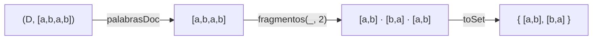
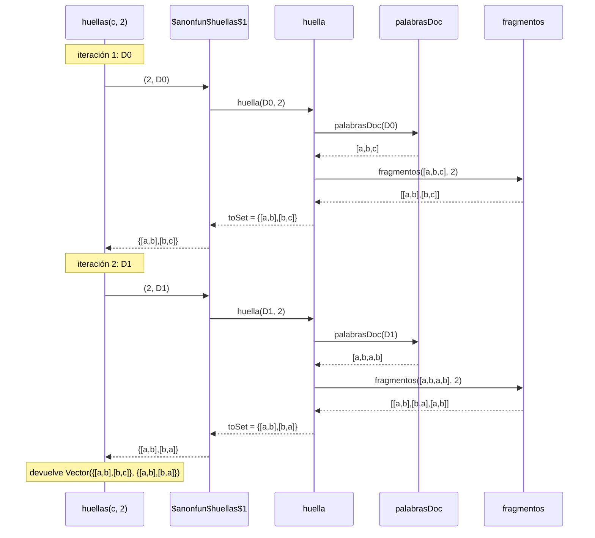

```mermaid
flowchart LR
    A["&quot;¡Expecto Patronum!&quot;"] -->|toLowerCase| B["&quot;¡expecto patronum!&quot;"]
    B -->|"StringOps.map"| C["&quot; expecto patronum &quot;"]
    C -->|"StringOps.split(' ')"| D["'' · expecto · patronum"]
    D -->|"ArrayOps.filter"| E["expecto · patronum"]
    E -->|"wrapRefArray.toVector"| F["Vector(expecto, patronum)"]
```

# Informe de proceso

Este informe muestra cómo se ejecuta cada función de la solución secuencial,
llamado por llamado e iteración por iteración, y en qué operaciones la
traduce el compilador.

## Cómo traduce el compilador nuestro código

En `normalizar`, `huella` y `huellas` usamos llamados a `map`, `filter`,
`split`, `toSet` y `toVector`. Aquí se explica qué hace el compilador con esos
llamados.

Para no suponerlo, compilamos `Similitud.scala` con el compilador de Scala
2.13.11 (el del proyecto) pidiéndole que muestre el código después de dos de
sus fases:

```bash
scalac -Xprint:typer      Similitud.scala   # después de revisar los tipos
scalac -Xprint:delambdafy Similitud.scala   # después de convertir las lambdas
```

En esas dos fases el compilador hace tres cosas sobre nuestro código:

1. Inserta conversiones implícitas. `String` y `Array` son clases de Java y
   no tienen métodos como `map` o `filter`. El compilador envuelve el valor en
   una clase de Scala que sí los tiene, usando conversiones definidas en
   `scala.Predef`:
   - `augmentString(s)` convierte un `String` en `StringOps`.
   - `refArrayOps(a)` convierte un `Array` en `ArrayOps`.
   - `wrapRefArray(a)` convierte un `Array` en una colección de Scala.
   - `charWrapper(c)` convierte un `Char` en `RichChar`.

   `Vector` y `Set` ya son colecciones de Scala, así que sobre ellos el llamado
   queda directo, sin conversión.
2. Convierte esos métodos en métodos estáticos de extensión. Por ejemplo,
   `augmentString(s).map(f)` termina como `StringOps.map$extension(s, f)`: no
   se crea ningún objeto `StringOps` en tiempo de ejecución.
3. Convierte cada lambda en un método. Cada función anónima `x => ...` pasa
   a ser un método estático con un nombre como `$anonfun$normalizar$1`, y en
   el punto donde estaba la lambda queda un objeto función que apunta a ese
   método. Si la lambda usa una variable de afuera (como `k` en `huellas`),
   esa variable se le pasa como parámetro extra al método.

---

## Punto 1: `normalizar`

```scala
def normalizar(texto: String): Vector[String] = {
  val minuscula  = texto.toLowerCase
  val conEspacio = minuscula.map(char => if (char.isLetterOrDigit) char else ' ')
  val divide     = conEspacio.split(' ')
  val filtra     = divide.filter(letras => letras.nonEmpty)
  filtra.toVector
}
```

`normalizar` no es recursiva: es una cadena de transformaciones, cada una
aplicada sobre el resultado de la anterior.

#### Paso a paso con `normalizar("¡Expecto Patronum!")`

| Paso | Operación | Valor |
|---|---|---|
| 1 | `texto.toLowerCase` | `"¡expecto patronum!"` |
| 2 | `map` carácter a carácter | `" expecto patronum "` |
| 3 | `split(' ')` | `Array("", "expecto", "patronum")` |
| 4 | `filter(_.nonEmpty)` | `Array("expecto", "patronum")` |
| 5 | `toVector` | `Vector("expecto", "patronum")` |

En el paso 3, el espacio del comienzo (el que dejó `¡`) produce una cadena
vacía `""` al principio del arreglo; el filtro del paso 4 la elimina. El espacio
final (el que dejó `!`) no produce cadena vacía porque `split` descarta las
vacías del final.

#### Cómo lo traduce el compilador

Después de la fase `typer`, el cuerpo de `normalizar` queda así (salida real
del compilador):

```scala
val minuscula: String = texto.toLowerCase();
val conEspacio: String = scala.Predef.augmentString(minuscula).map(((char: Char) =>
  if (scala.Predef.charWrapper(char).isLetterOrDigit) char else ' '));
val divide: Array[String] = scala.Predef.augmentString(conEspacio).split(' ');
val filtra: Array[String] = scala.Predef.refArrayOps[String](divide).filter(((letras: String) =>
  scala.Predef.augmentString(letras).nonEmpty));
scala.Predef.wrapRefArray[String](filtra).toVector
```

Y después de la fase `delambdafy`:

```scala
val minuscula: String = texto.toLowerCase();
val conEspacio: String = StringOps.map$extension(augmentString(minuscula), $anonfun$normalizar$1);
val divide: Array[String] = StringOps.split$extension(augmentString(conEspacio), ' ');
val filtra: Array[String] = ArrayOps.filter$extension(refArrayOps(divide), $anonfun$normalizar$2);
...

def $anonfun$normalizar$1(char: Char): Char =
  if (RichChar.isLetterOrDigit$extension(charWrapper(char))) char else ' ';
def $anonfun$normalizar$2(letras: String): Boolean =
  StringOps.nonEmpty$extension(augmentString(letras));
```

Línea por línea:

| Paso | Lo que escribimos | Lo que genera el compilador |
|---|---|---|
| 1 | `texto.toLowerCase` | `texto.toLowerCase()`: método de `java.lang.String`, sin conversión. |
| 2 | `minuscula.map(char => ...)` | `StringOps.map$extension(augmentString(minuscula), f)`. La lambda pasa a ser el método `$anonfun$normalizar$1(char: Char): Char`. Como la función devuelve `Char`, se usa la versión de `map` que devuelve `String`. |
| 2 | `char.isLetterOrDigit` | `RichChar.isLetterOrDigit$extension(charWrapper(char))`. |
| 3 | `conEspacio.split(' ')` | `StringOps.split$extension(augmentString(conEspacio), ' ')`, que devuelve `Array[String]`. |
| 4 | `divide.filter(letras => ...)` | `ArrayOps.filter$extension(refArrayOps(divide), f)`. La lambda pasa a ser el método `$anonfun$normalizar$2(letras: String): Boolean`. |
| 4 | `letras.nonEmpty` | `StringOps.nonEmpty$extension(augmentString(letras))`. |
| 5 | `filtra.toVector` | `wrapRefArray(filtra).toVector`: el arreglo se envuelve como colección de Scala y de ahí se copia a un `Vector`. |

#### Iteración por iteración

Paso 1: `toLowerCase`.Un solo llamado sobre todo el texto:

```scala
"¡Expecto Patronum!".toLowerCase   // "¡expecto patronum!"
```

Paso 2: `StringOps.map$extension` sobre `"¡expecto patronum!"`. El `map`
recorre los 18 caracteres uno por uno; en cada iteración llama a
`$anonfun$normalizar$1(char)` y agrega lo que devuelve al `String` que está
construyendo.

| Iteración | `char` | `char.isLetterOrDigit` | `$anonfun$normalizar$1(char)` | Resultado acumulado |
|---|---|---|---|---|
| 1 | `'¡'` | `false` | `' '` | `" "` |
| 2 | `'e'` | `true` | `'e'` | `" e"` |
| 3 | `'x'` | `true` | `'x'` | `" ex"` |
| 4 | `'p'` | `true` | `'p'` | `" exp"` |
| 5 | `'e'` | `true` | `'e'` | `" expe"` |
| 6 | `'c'` | `true` | `'c'` | `" expec"` |
| 7 | `'t'` | `true` | `'t'` | `" expect"` |
| 8 | `'o'` | `true` | `'o'` | `" expecto"` |
| 9 | `' '` | `false` | `' '` | `" expecto "` |
| 10 | `'p'` | `true` | `'p'` | `" expecto p"` |
| 11 | `'a'` | `true` | `'a'` | `" expecto pa"` |
| 12 | `'t'` | `true` | `'t'` | `" expecto pat"` |
| 13 | `'r'` | `true` | `'r'` | `" expecto patr"` |
| 14 | `'o'` | `true` | `'o'` | `" expecto patro"` |
| 15 | `'n'` | `true` | `'n'` | `" expecto patron"` |
| 16 | `'u'` | `true` | `'u'` | `" expecto patronu"` |
| 17 | `'m'` | `true` | `'m'` | `" expecto patronum"` |
| 18 | `'!'` | `false` | `' '` | `" expecto patronum "` |

Las iteraciones 1 y 18 son las que cambian algo: los signos de exclamación `¡`
y `!` se vuelven espacios. La iteración 9 también da `false`, pero el carácter
ya era un espacio.

Paso 3: `StringOps.split$extension`. Un solo llamado. Corta el texto en
cada espacio:

```scala
" expecto patronum ".split(' ')   // Array("", "expecto", "patronum")
```

Paso 4: `ArrayOps.filter$extension` sobre
`Array("", "expecto", "patronum")`. El `filter` recorre los 3 trozos; en cada
iteración llama a `$anonfun$normalizar$2(letras)` y, si devuelve `true`,
agrega el trozo al arreglo nuevo que está construyendo.

| Iteración | `letras` | `$anonfun$normalizar$2(letras)` | ¿Lo conserva el `filter`? | Resultado acumulado |
|---|---|---|---|---|
| 1 | `""` | `false` | no | `Array()` |
| 2 | `"expecto"` | `true` | sí | `Array("expecto")` |
| 3 | `"patronum"` | `true` | sí | `Array("expecto", "patronum")` |

Paso 5: `wrapRefArray(...).toVector`. Un solo llamado que copia el arreglo
a un vector:

```scala
Array("expecto", "patronum").toVector   // Vector("expecto", "patronum")
```



---

## `huella`

```scala
def huella(d: Documento, k: Int): Huella = {
  val palabras = palabrasDoc(d)
  val frags    = fragmentos(palabras, k)
  frags.toSet
}
```

`huella` no es recursiva: toma las palabras del documento, calcula sus
fragmentos con `fragmentos` y convierte el vector en conjunto. La conversión
`toSet` es la que hace que un fragmento repetido cuente una sola vez.

#### Cómo lo traduce el compilador

Salida de la fase `typer`:

```scala
val palabras: Vector[String] = Similitud.this.palabrasDoc(d);
val frags: Vector[Fragmento] = Similitud.this.fragmentos(palabras, k);
frags.toSet[Fragmento]
```

Aquí el compilador no inserta conversiones ni crea lambdas: los dos primeros
son llamados directos a métodos del objeto `Similitud`, y `toSet` es un método
que `Vector` ya tiene. Lo único que agrega es el parámetro de tipo:
`toSet[Fragmento]`, es decir, el conjunto resultante es un `Set[Vector[String]]`.

#### Paso a paso con `huella(("D", Vector("a", "b", "a", "b")), 2)`

| Paso | Operación | Valor |
|---|---|---|
| 1 | `palabrasDoc(d)` | `Vector(a, b, a, b)` |
| 2 | `fragmentos(palabras, 2)` | `Vector([a,b], [b,a], [a,b])` |
| 3 | `toSet` | `Set([a,b], [b,a])` |

#### Llamado por llamado

```scala
huella(("D", Vector("a", "b", "a", "b")), 2)
  palabrasDoc(("D", Vector("a", "b", "a", "b")))   // Vector(a, b, a, b)
  fragmentos(Vector(a, b, a, b), 2)                // Vector([a,b], [b,a], [a,b])
  Vector([a,b], [b,a], [a,b]).toSet                // Set([a,b], [b,a])
```

`toSet` recorre el vector de fragmentos y va agregando cada uno a un conjunto
que empieza vacío. Si el fragmento ya está, el conjunto no cambia:

| Iteración | Fragmento | ¿Ya estaba? | Conjunto acumulado |
|---|---|---|---|
| — | — | — | `Set()` |
| 1 | `[a,b]` | no | `Set([a,b])` |
| 2 | `[b,a]` | no | `Set([a,b], [b,a])` |
| 3 | `[a,b]` | sí | `Set([a,b], [b,a])` |

El vector del paso 2 tiene $t - k + 1 = 3$ fragmentos, pero `[a,b]` aparece dos
veces (iteraciones 1 y 3), así que la huella queda con 2. Por eso en general

$$|\text{huella}(d, k)| \le t - k + 1.$$



## `huellas`

```scala
def huellas(c: Corpus, k: Int): Vector[Huella] =
  c.map(documento => huella(documento, k))
```

`huellas` aplica `huella` a cada documento del corpus y conserva el orden, de
modo que la huella en la posición `i` corresponde al documento `i`. Esa
correspondencia es la que usan después `indiceInvertido` y `similitudes` para
identificar los documentos por su posición.

#### Cómo lo traduce el compilador

Salida de la fase `typer`:

```scala
c.map[Huella](((documento: Documento) => Similitud.this.huella(documento, k)))
```

Salida de la fase `delambdafy`:

```scala
def huellas(c: Vector, k: Int): Vector = c.map($anonfun(k))

def $anonfun$huellas$1(k$1: Int, documento: Tuple2): Set = Similitud.huella(documento, k$1);
```

- `c` es un `Vector`, así que `map` se llama directo, sin conversión implícita.
- El compilador fija el tipo del resultado: `map[Huella]`.
- La lambda `documento => huella(documento, k)` pasa a ser el método
  `$anonfun$huellas$1`. Como la lambda usa `k`, que viene de afuera, el
  compilador se lo pasa como primer parámetro (`k$1`), y en el lugar de la
  lambda queda `$anonfun(k)`: un objeto función que ya trae guardado el valor
  de `k`.

#### Paso a paso con un corpus de dos documentos y `k = 2`

```scala
val c = Vector(("D0", Vector("a", "b", "c")), ("D1", Vector("a", "b", "a", "b")))
huellas(c, 2)
```

| Elemento que recorre el `map` | Lo que devuelve `$anonfun$huellas$1(2, documento)` |
|---|---|
| `("D0", [a,b,c])` | `huella(_, 2) = {[a,b], [b,c]}` |
| `("D1", [a,b,a,b])` | `huella(_, 2) = {[a,b], [b,a]}` |

#### Iteración por iteración

El `map` hace una iteración por documento, y en cada una llama a
`$anonfun$huellas$1(2, documento)`, que a su vez hace un llamado completo a
`huella`:

Iteración 1 — `documento = ("D0", Vector(a, b, c))`:

```scala
$anonfun$huellas$1(2, ("D0", Vector(a, b, c)))
  huella(("D0", Vector(a, b, c)), 2)
    palabrasDoc(("D0", Vector(a, b, c)))   // Vector(a, b, c)
    fragmentos(Vector(a, b, c), 2)         // Vector([a,b], [b,c])
    Vector([a,b], [b,c]).toSet             // Set([a,b], [b,c])
```

Resultado acumulado: `Vector({[a,b], [b,c]})`.

Iteración 2 — `documento = ("D1", Vector(a, b, a, b))`:

```scala
$anonfun$huellas$1(2, ("D1", Vector(a, b, a, b)))
  huella(("D1", Vector(a, b, a, b)), 2)
    palabrasDoc(("D1", Vector(a, b, a, b)))   // Vector(a, b, a, b)
    fragmentos(Vector(a, b, a, b), 2)         // Vector([a,b], [b,a], [a,b])
    Vector([a,b], [b,a], [a,b]).toSet         // Set([a,b], [b,a])
```

Resultado acumulado: `Vector({[a,b], [b,c]}, {[a,b], [b,a]})`.

No quedan documentos, así que el `map` termina.



Resultado: `Vector({[a,b], [b,c]}, {[a,b], [b,a]})`, una huella por documento y
en el mismo orden del corpus.

---

## Resumen de la traducción

| Función | Lo que escribimos | Lo que genera el compilador | Lambdas generadas |
|---|---|---|---|
| `normalizar` | `minuscula.map(...)` | `StringOps.map$extension(augmentString(minuscula), f)` | `$anonfun$normalizar$1(char: Char): Char` |
| `normalizar` | `conEspacio.split(' ')` | `StringOps.split$extension(augmentString(conEspacio), ' ')` | — |
| `normalizar` | `divide.filter(...)` | `ArrayOps.filter$extension(refArrayOps(divide), f)` | `$anonfun$normalizar$2(letras: String): Boolean` |
| `normalizar` | `filtra.toVector` | `wrapRefArray(filtra).toVector` | — |
| `huella` | `frags.toSet` | `frags.toSet[Fragmento]` (directo, sin conversión) | — |
| `huellas` | `c.map(documento => huella(documento, k))` | `c.map[Huella]($anonfun(k))` (directo, sin conversión) | `$anonfun$huellas$1(k$1: Int, documento): Set` |
